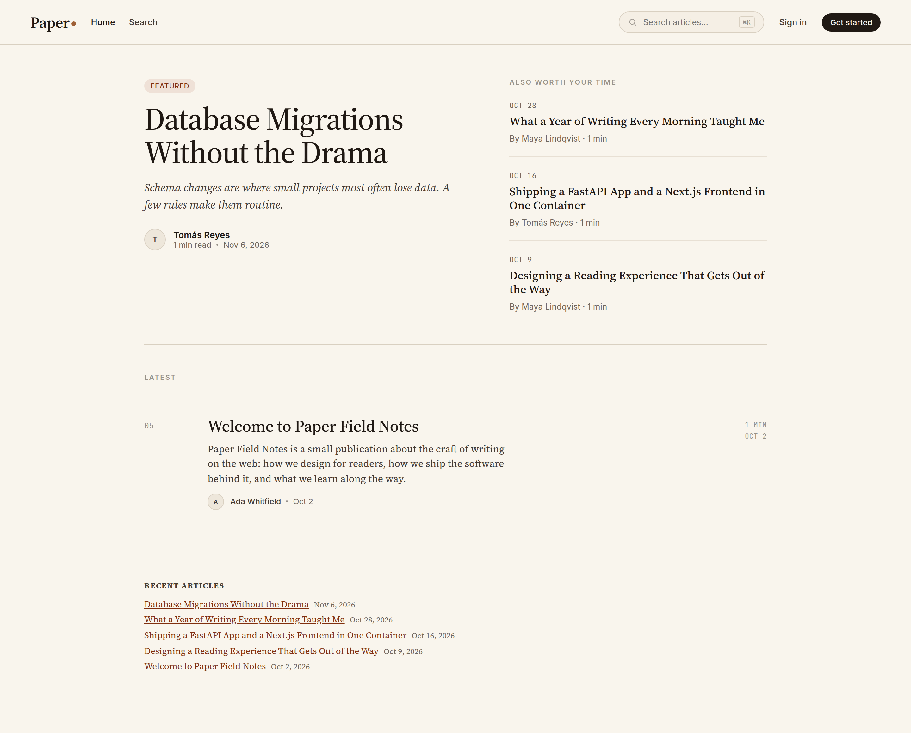
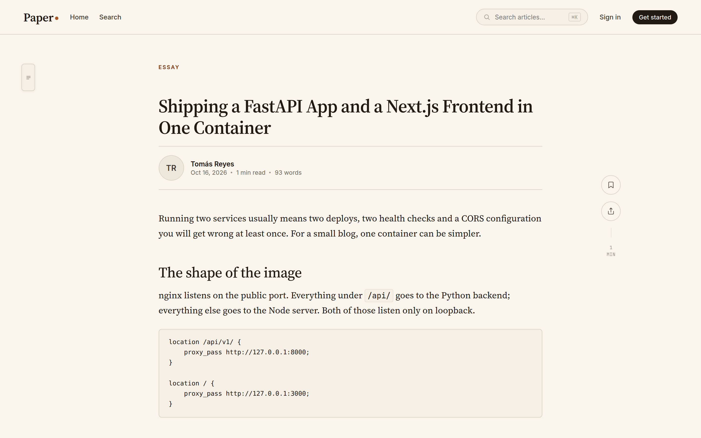
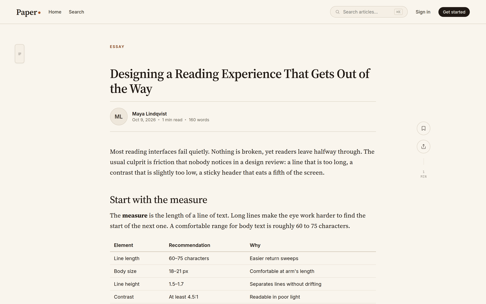
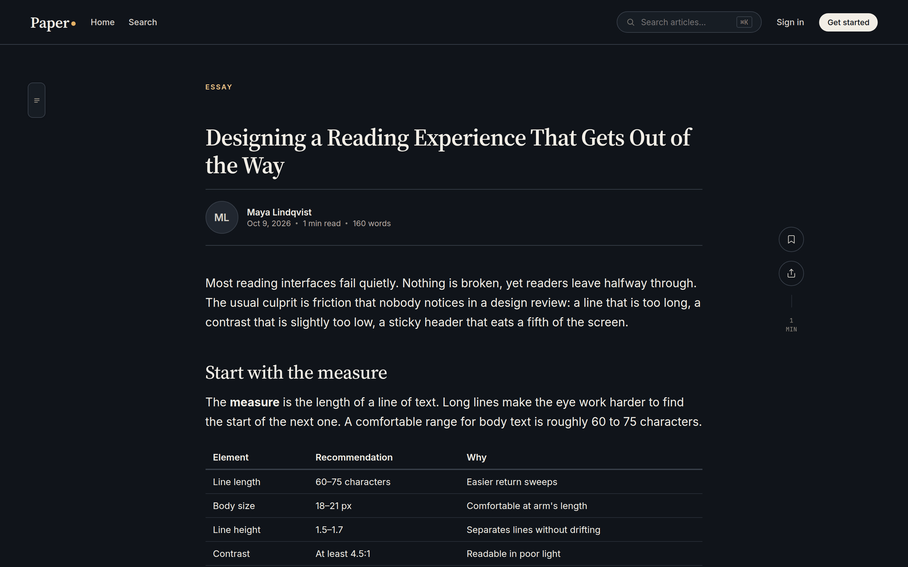
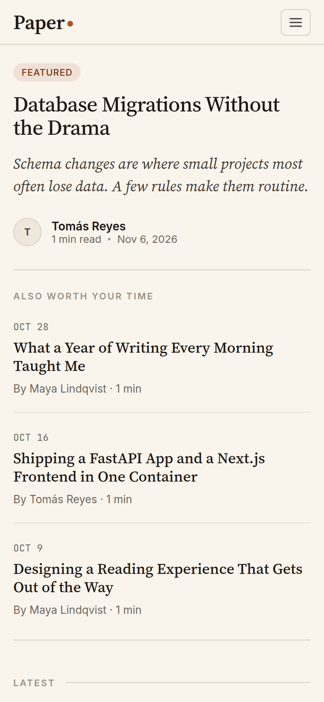
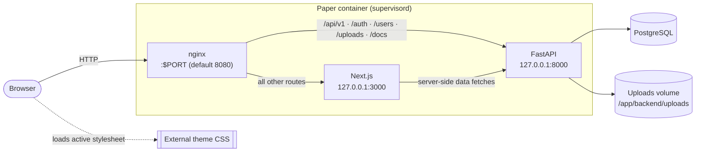

<div align="center">

# Paper

*The blog platform that wears any coat.*

[](LICENSE)
[](https://www.python.org)
[](https://fastapi.tiangolo.com)
[](https://nextjs.org)
[](https://www.typescriptlang.org)
[](Dockerfile)
[](https://r15hav.github.io/blog/)

**[Documentation](https://r15hav.github.io/blog/)** · **[Quick Start](#quick-start-docker-compose)** · **[Deployment](#deployment)**

</div>



---

## What is Paper?

Paper is a self-hosted, open-source blog platform for **independent writers**, **developers who prefer to run their own software**, and **small publishing teams**.

Two things set it apart:

- **Restyle the whole site without redeploying.** Paste a CSS stylesheet URL into the admin panel and activate it. Every visitor gets the new look within about 60 seconds, with no rebuild or restart.
- **Deploy it as one container.** nginx, the FastAPI backend and the Next.js frontend run together in a single Docker image. Only one port is exposed. Run it on Render, on any Docker host, or locally with `docker compose up`.

Writers compose articles in a block-based **Editor.js** editor. New accounts stay **inactive until an administrator approves them**, so you control who can take part.

> Paper is under active development and has no tagged release yet. Read [Current limitations](#current-limitations) before relying on it.

---

## Features

### ✍️ Writing
- Block-based editor (Editor.js) with headings, lists, quotes, code blocks, inline code, highlights, tables, embeds, delimiters, warnings, alerts, raw HTML and images by URL
- Publish an article or keep it as a draft, and edit or delete it later
- Author dashboard showing your articles, the comments on them, and stats



### 💬 Community
- Readers can like and comment on articles
- Search articles by title
- Account settings for each user: bio, work experience, qualifications and education
- Three roles: **guest** (read, like, comment), **author** (write and manage own articles), **admin** (everything)

### 🎨 Customization
- Live theme switching: register external CSS theme URLs and activate one at a time
- Site settings: name, description, logo upload and social-sharing (OpenGraph/Twitter) metadata
- A setting to open or close self-registration (the backend rejects sign-ups while it's closed)

<table>
  <tr>
    <th width="50%">Paper Classic (built-in look)</th>
    <th width="50%">Ink (example dark theme)</th>
  </tr>
  <tr>
    <td></td>
    <td></td>
  </tr>
</table>

*The same article on the same running instance, before and after switching the active theme in **Admin → Theme**, with no rebuild or redeploy. Ink is a demo stylesheet that only overrides Paper's documented CSS variables; it isn't bundled with the repository.*

<p align="center">
  
</p>

### ⚙️ Operations
- Single Docker image: nginx + FastAPI + Next.js, managed by supervisord, with a `/healthz` health check
- Admin panel for activating users, assigning roles, moderating articles and comments, and viewing site stats
- SQLite with zero setup for local development; PostgreSQL in production, with Alembic migrations run at container start
- Server-rendered pages with metadata, `sitemap.xml` and `robots.txt`
- Optional hCaptcha on the login and registration forms (off by default)

---

## Technology stack

| Layer | Technology |
|---|---|
| Frontend | Next.js 16 (App Router), React 19, Editor.js, Tailwind CSS 4, JavaScript and TypeScript |
| Backend | Python 3.12+, FastAPI, fastapi-users (JWT auth), SQLAlchemy 2 (async), Alembic |
| Database | PostgreSQL (production, via asyncpg) or SQLite (local, via aiosqlite) |
| Runtime | Docker, nginx, supervisord |
| Hosting | Render Blueprint ([`render.yaml`](render.yaml)) or any Docker host |

---

## Architecture

In production, everything runs inside one container. Only nginx is publicly reachable; FastAPI and Next.js listen on loopback only.



The browser calls the API on the same origin, through nginx. During server-side rendering, Next.js calls FastAPI directly over loopback. For a deeper look at the backend layers, the auth flow and the theme system, see the [Contributor Guide → Architecture](https://r15hav.github.io/blog/guide.html#cg-architecture).

---

## Quick start (Docker Compose)

The fastest way to see Paper running. You only need Docker.

```bash
git clone https://github.com/R15hav/blog.git
cd blog
FIRST_ADMIN_EMAIL=you@example.com docker compose up --build -d
```

The app takes a little while to start. It waits for PostgreSQL, runs database migrations, then launches its services. Check its status:

```bash
docker compose ps
```

Wait until the `app` service's STATUS shows `(healthy)` rather than `(health: starting)`. Requests made before then may fail.

Then:

1. Open **http://localhost:8080/register** and sign up with the email you passed as `FIRST_ADMIN_EMAIL`.
2. Restart the app so the startup routine promotes and activates that account:
   ```bash
   docker compose restart app
   ```
3. Log in. The admin panel is at **http://localhost:8080/admin**.

Compose starts PostgreSQL 16 (reachable only on the internal network) plus the Paper container, and keeps uploads in a named volume. The `SECRET` in [`docker-compose.yml`](docker-compose.yml) is a development value; change it for anything public.

---

## Local development

**Prerequisites:** Python 3.12+, Node.js 24 LTS ([nvm](https://github.com/nvm-sh/nvm) recommended), and [`uv`](https://github.com/astral-sh/uv).

```bash
git clone https://github.com/R15hav/blog.git
cd blog
```

### 1. Backend (terminal 1)

```bash
cd backend
touch .env   # creates backend/.env only if it is missing; never overwrites an existing file
```

Open `backend/.env` and add this line, or update it if it already exists. Leave every other setting in the file as it is:

```dotenv
FIRST_ADMIN_EMAIL=you@example.com
```

Then, still in `backend/`, start the API:

```bash
uv run --env-file .env uvicorn app.app:app --reload --port 8000
```

- With no `DATABASE_URL` set, the backend uses SQLite (`backend/test.db`) and creates the tables on first start.
- **Pass `--env-file .env`.** Neither `uv` nor the app loads `backend/.env` automatically, so without the flag `FIRST_ADMIN_EMAIL` and any other values in the file are ignored.
- [`backend/.env.example`](backend/.env.example) lists every backend option. Its `DATABASE_URL` points to a local PostgreSQL server, so leave that line out if you want SQLite.

### 2. Frontend (terminal 2)

```bash
cp frontend/.env.example frontend/.env.local
cd frontend
npm install
npm run dev
```

`frontend/.env.local` sets `NEXT_PUBLIC_API_URL=http://localhost:8000`. **Don't skip this step.** Without it, the login, registration and admin pages call `localhost:3000`, which has no API routes, and they fail. After editing `.env.local`, restart `npm run dev`.

| Service | URL |
|---|---|
| Frontend | http://localhost:3000 |
| Backend API | http://localhost:8000 |
| Interactive API docs (Swagger) | http://localhost:8000/docs |

### 3. Bootstrap the first administrator

New accounts are created **inactive**. The backend promotes and activates the `FIRST_ADMIN_EMAIL` account **when it starts**, so do it in this order:

1. Set `FIRST_ADMIN_EMAIL` in `backend/.env` (done in step 1).
2. Register at http://localhost:3000/register using that email.
3. Restart the backend (stop with `Ctrl+C`, then run the `uv run --env-file .env …` command again).
4. Log in and open http://localhost:3000/admin to confirm you have administrator access.

From then on, you activate other users and grant the **author** role from **Admin → Users**.

### Common pitfalls

- **Run backend commands from `backend/`, not the repository root.** `uv` looks for `pyproject.toml` in the current directory. From the root you'll get `ModuleNotFoundError: No module named 'uvicorn'`.
- **Use Node.js 24 (LTS).** That's what CI and the Docker image use, and some dependencies require it. The system Node on Debian/Ubuntu is often much older; Next.js 16 rejects anything below 20.9 with `version ">=20.9.0" is required`.
- **Schema changes need an Alembic migration** (`uv run alembic revision --autogenerate -m "…"`). Creating tables at startup won't alter existing ones.

---

## Deployment

| Option | What you get | Guide |
|---|---|---|
| **Render** (Docker web service + Blueprint) | Hosted app with managed PostgreSQL and a persistent disk for uploads | [render-deploy.md](render-deploy.md) |
| **Docker Compose** | PostgreSQL + Paper on `localhost:8080` | [Quick start](#quick-start-docker-compose) |
| **Any Docker host** | One image you can run anywhere | [User Manual → Deploy with Docker](https://r15hav.github.io/blog/guide.html#um-deploy-docker) |

The production artifact is the root [`Dockerfile`](Dockerfile), a three-stage build: Next.js standalone build → Python dependencies with `uv` → slim runtime with nginx, supervisord and Node 24. At startup, [`deploy/start.sh`](deploy/start.sh) renders the nginx config, runs `alembic upgrade head` when `DATABASE_URL` is set, and hands off to supervisord.

**Don't set `NEXT_PUBLIC_API_URL` for the single-container build.** The browser reaches the API on the same origin through nginx.

---

## Configuration

| Variable | Default | Purpose |
|---|---|---|
| `DATABASE_URL` | `sqlite+aiosqlite:///./test.db` | Database connection. `postgres://` and `postgresql://` URLs are converted for asyncpg automatically. For PostgreSQL, `sslmode` accepts `disable`, `prefer` or `require`; **without it, SSL is required**. Use `?sslmode=disable` for a database without SSL, as [`docker-compose.yml`](docker-compose.yml) does. |
| `SECRET` | `dev-secret-change-me` | JWT signing secret. **Override it in production.** |
| `FIRST_ADMIN_EMAIL` | (unset) | Promotes and activates this account as administrator on every backend startup. |
| `FRONTEND_URL` | `http://localhost:3000` | CORS allowed origin. In the single container, set it to the public URL. |
| `PORT` | `8080` | Port nginx listens on in the container (Render sets this). |
| `NEXT_PUBLIC_API_URL` | `http://localhost:8000` in `frontend/.env.example` | Backend URL for the browser in **local development only**. Leave it unset for Docker builds. |
| `HCAPTCHA_ENABLED` | `false` | Enables hCaptcha on login and registration. Optional. |

**hCaptcha is optional and off by default.** Enabling it takes a server-side secret (`HCAPTCHA_SECRET`) and a public site key (`NEXT_PUBLIC_HCAPTCHA_SITE_KEY`), which is baked in at build time. For setup steps and sandbox test keys, see [Enabling hCaptcha](render-deploy.md#enabling-hcaptcha-on-register-and-login-optional) and the [environment variable reference](https://r15hav.github.io/blog/guide.html#um-deploy-env).

---

## Current limitations

Paper is still in development. These are known gaps today:

- **Password reset isn't implemented.** The forgot-password page is a placeholder and no reset emails are sent.
- **Articles can't upload images.** Article images are embedded by external URL. The site logo is the only file you can upload.
- **No frontend tests, and lint isn't enforced.** CI ([`.github/workflows/ci.yml`](.github/workflows/ci.yml)) runs the backend test suite and the frontend production build on every pull request and push to `master`. There are no frontend tests, and `npm run lint` reports existing errors on `master`, so it isn't part of CI yet.
- **The bundled theme stylesheet is out of date.** `frontend/public/themes/default.css` predates the current CSS variables and only partly applies if you activate it ([#28](https://github.com/R15hav/blog/issues/28)). Themes written against the current variables work.

Contributions toward any of these are welcome. See [Contributing](#contributing).

---

## Documentation

Full documentation is published at **[r15hav.github.io/blog](https://r15hav.github.io/blog/)**:

- 👤 **[User Manual](https://r15hav.github.io/blog/guide.html#um-overview):** reading, writing, administering your site, and deploying your own instance
- 🛠️ **[Contributor Guide](https://r15hav.github.io/blog/guide.html#cg-overview):** architecture, local setup, gotchas and how to send a PR
- 🔌 **[API reference](https://r15hav.github.io/blog/guide.html#cg-api):** backend endpoints
- 🚀 **[Render deployment guide](render-deploy.md):** step-by-step hosted deployment

---

## Contributing

PRs are welcome. See [CONTRIBUTING.md](CONTRIBUTING.md) for setup, branch and commit conventions, and a link to the in-depth Contributor Guide. By contributing, you agree to the [Code of Conduct](CODE_OF_CONDUCT.md).

## Security

Please **don't** report vulnerabilities in a public issue. Follow [SECURITY.md](SECURITY.md) instead.

## License

[MIT](LICENSE) © 2026 R15hav
